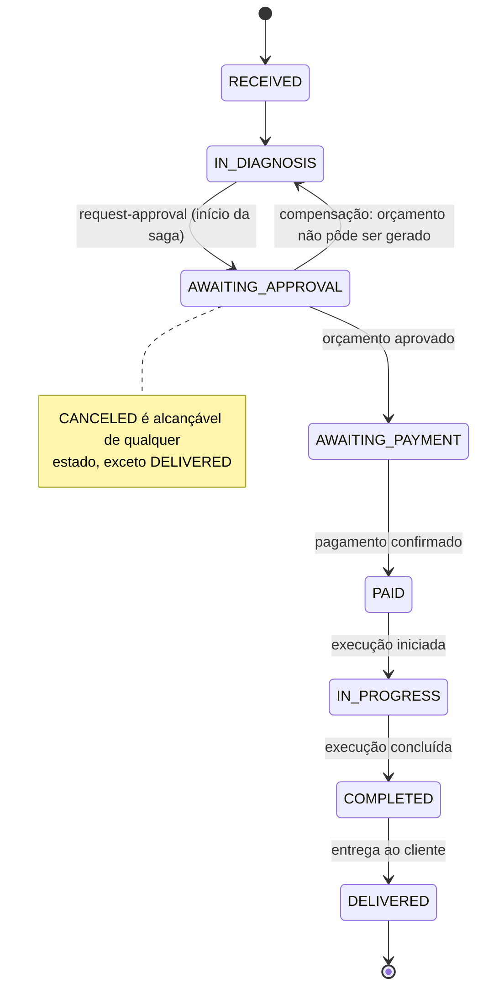

# ADR-011 — Saga orquestrada, com o orquestrador no OS Service

**Status:** Aceita · **Data:** 2026-11-14

## Contexto

Com três serviços e três bancos ([ADR-009](adr-009-divisao-em-microsservicos.md)), o fluxo principal da oficina deixa de caber em uma transação:

> abrir OS → gerar orçamento (Billing) → aguardar aprovação (Billing) → cobrar (Billing + Mercado Pago) → executar (Execution) → concluir (OS)

Cada etapa grava em um banco diferente, em momentos diferentes, às vezes com dias de intervalo. Se uma etapa falha depois que as anteriores já gravaram, alguém precisa desfazer o que foi feito: devolver peças ao estoque, cancelar o orçamento, estornar o pagamento. O enunciado exige o **Saga Pattern** com **compensação em qualquer etapa** e a justificativa da forma escolhida.

## Decisão

**Saga orquestrada.** O orquestrador vive no **OS Service**, que manda comandos aos outros serviços e reage aos eventos que eles publicam, sempre via RabbitMQ ([ADR-010](adr-010-mensageria-com-rabbitmq.md)).

### Por que orquestrada, e não coreografada

| Critério | Orquestrada | Coreografada |
|---|---|---|
| Onde está o estado do fluxo | Em uma tabela, `saga_instances`, no OS | Espalhado: cada serviço sabe só o seu pedaço |
| "Em que passo está a OS 123?" | Uma consulta (`GET /api/service-orders/:id/saga`) | Reconstruir a partir dos logs de três serviços |
| Quem decide compensar | O orquestrador, em um só lugar, com a matriz abaixo | Cada serviço precisa escutar as falhas dos outros e saber o que desfazer |
| Acoplamento | Billing e Execution não se conhecem; só respondem a comandos | Cada serviço precisa conhecer os eventos de quem vem antes dele |
| Timeout ("o cliente nunca pagou") | Natural: o orquestrador tem prazo por passo | Ninguém é dono do prazo |
| Teste do fluxo inteiro | Máquina de estados pura, testável sem broker (usada no BDD) | Exige os três serviços de pé |

O fator decisivo é que **a máquina de estados da OS já mora no OS Service** (`ServiceOrderStatusVO`). A saga é, na prática, a extensão dessa máquina para além do próprio banco. Colocar o orquestrador ali evita um quarto componente e mantém num só lugar a pergunta "o que acontece com a OS agora?".

O custo assumido é o OS Service ficar mais pesado e ser o ponto de coordenação. Isso é aceitável porque ele não é ponto único de falha do fluxo: se cair, os eventos esperam na fila `os.saga-events` e a saga continua de onde parou.

### Nova máquina de estados da OS



Status novos: `AWAITING_PAYMENT` e `PAID`. Transição nova: `AWAITING_APPROVAL → IN_DIAGNOSIS`, que só é usada como compensação.

### Pagamento antes da execução

A oficina cobra **depois da aprovação e antes de executar**. Isso foi escolhido de propósito. Com cobrança no fim, uma falha na execução não teria nada financeiro a desfazer, e a única compensação seria trocar status. Com cobrança antes, a falha na execução exige **estorno no Mercado Pago**, a compensação mais significativa do fluxo, porque mexe com dinheiro em um sistema externo.

### Passos e compensações

| # | Passo | Comando enviado | Sucesso | Falha ou timeout | Compensação |
|---|---|---|---|---|---|
| 1 | Gerar orçamento | `billing.budget.create` | `billing.budget.created` | `billing.budget.creation-failed` | OS → `IN_DIAGNOSIS`. Saga `COMPENSATED` |
| 2 | Aguardar aprovação | — | `billing.budget.approved` → reserva peças, OS → `AWAITING_PAYMENT` | `billing.budget.rejected` ou `SAGA_APPROVAL_TIMEOUT` | `billing.budget.cancel` → `canceled`. OS → `CANCELED` |
| 3 | Aguardar pagamento | — | `billing.payment.confirmed` → OS → `PAID` | `billing.payment.failed` ou `SAGA_PAYMENT_TIMEOUT` | Devolve peças. `billing.budget.cancel` → `canceled`. OS → `CANCELED` |
| 4 | Enfileirar execução | `execution.job.enqueue` | `execution.job.queued` | — (retentativa e DLQ) | — |
| 5 | Executar | — | `execution.job.started` → OS → `IN_PROGRESS`; `execution.job.completed` → OS → `COMPLETED`. Saga `COMPLETED` | `execution.job.failed` | `billing.payment.refund` → `refunded`. Devolve peças. OS → `CANCELED` |
| — | Cancelamento manual pela equipe | — | — | `cancel-order` com saga `RUNNING` | Compensa o passo atual: `execution.job.cancel` se enfileirada, estorno se paga, cancelamento de orçamento se não paga |

**A reserva de peças é local.** Baixar e devolver estoque acontece no OS, na mesma transação que muda o status da OS e grava a próxima mensagem no outbox. Não há passo remoto que possa falhar entre as duas operações.

**A compensação também pode falhar.** Se o estorno for recusado pelo Mercado Pago (`billing.payment.refund-failed`), a saga vai para `FAILED`, o que dispara alerta e exige intervenção manual. Uma compensação de dinheiro que falha não se resolve com mais automação.

### Estado da saga

```
saga_instances
  id, order_id (único), step, status, deadline_at, last_error, created_at, updated_at

saga_step_logs
  id, saga_id, step, event_type, message_id, outcome, created_at
```

`status`: `RUNNING` → `COMPLETED`, ou `RUNNING` → `COMPENSATING` → `COMPENSATED`, ou `FAILED` quando a compensação falha. O histórico fica em tabela, e não em JSON, pelo mesmo motivo da [ADR-008](adr-008-tabelas-de-juncao-no-lugar-de-json.md).

**Uma transação por evento.** Ao consumir um evento, o OS faz em uma única transação do Postgres:

1. registra o `messageId` (idempotência);
2. avança a saga e grava o log do passo;
3. muda o status da OS e, se for o caso, o estoque;
4. grava no outbox o próximo comando.

Ou tudo acontece, ou nada acontece e a mensagem volta para retentativa.

**O orquestrador é uma função pura** (`application/saga/service-order-saga.ts`): recebe o estado atual e o evento e devolve o novo estado e os comandos a emitir. Ele não depende de Nest, Prisma ou RabbitMQ. É o que permite testar todas as linhas da matriz acima sem infraestrutura e usá-lo direto no teste BDD.

### Timeouts

`deadline_at` é definido ao entrar nos passos 2 e 3, a partir de `SAGA_APPROVAL_TIMEOUT` e `SAGA_PAYMENT_TIMEOUT`. Uma varredura periódica (`@nestjs/schedule`) trata sagas `RUNNING` com o prazo vencido como falha do passo. Para a demonstração, os prazos são curtos (minutos); em produção, seriam dias.

### Eventos fora de ordem e repetidos

- **Repetido** (mesmo `messageId`): confirmado sem efeito.
- **De um passo já superado** (ex.: `billing.budget.created` chegando de novo depois da aprovação): registrado no log e confirmado sem efeito.
- **De um passo à frente** (ex.: `execution.job.completed` antes de `execution.job.started`, depois de uma retentativa): devolvido para retentativa. Quando o evento anterior chegar, o seguinte passa a ser válido.
- **Para uma saga encerrada** (`COMPLETED`, `COMPENSATED`): confirmado sem efeito e registrado como anomalia, com log em `warn` e métrica.

## Consequências

**Positivas**
- O fluxo inteiro de uma OS é visível em um lugar, por consulta, e não por arqueologia de logs.
- Toda falha tem uma compensação definida e testada, inclusive a que mexe com dinheiro.
- Billing e Execution ficam simples: recebem um comando, fazem a sua parte e respondem. Não sabem que existe uma saga.
- O fluxo é testável sem broker nem banco, porque o orquestrador é uma função pura.

**Negativas**
- **O OS Service concentra a coordenação.** Uma mudança no fluxo passa sempre por ele.
- **A OS fica visível em estados intermediários** (`AWAITING_PAYMENT` com o pagamento já aprovado no Mercado Pago, por alguns instantes). É inerente à consistência eventual.
- **A compensação não é rollback.** O cliente que teve o pagamento estornado vê a cobrança e o estorno no extrato. Isso é correto do ponto de vista do negócio, mas não é invisível.
- **Mais duas tabelas e uma varredura periódica** no OS Service.
