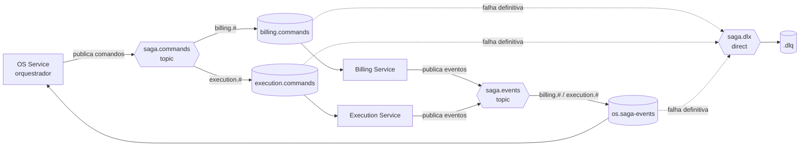
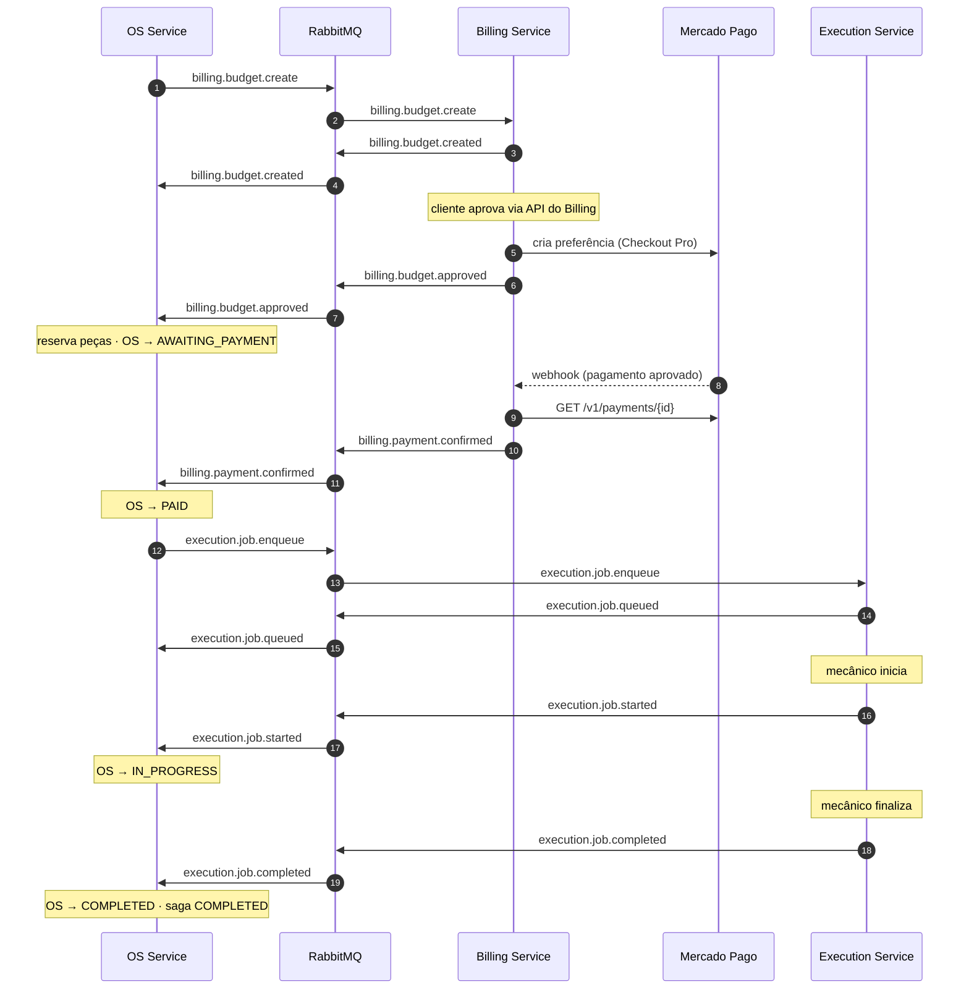
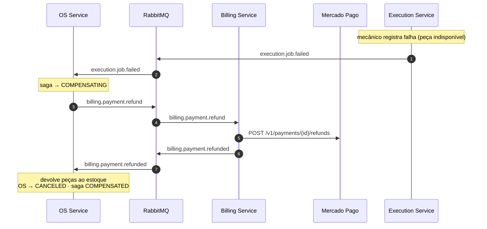

# Contratos de mensagens

Contrato de comunicação assíncrona entre **OS Service**, **Billing Service** e **Execution Service**, via RabbitMQ. É a fonte da verdade para os três repositórios: uma mudança aqui vem antes da mudança no código e é aplicada em todos os serviços afetados.

Decisões que originam este contrato: [ADR-010](../adr/adr-010-mensageria-com-rabbitmq.md) (RabbitMQ, outbox, idempotência) e [ADR-011](../adr/adr-011-saga-orquestrada.md) (saga orquestrada).

---

## 1. Convenções

| Item | Regra |
|---|---|
| **Comando** | Pedido do orquestrador para um serviço fazer algo. Nome no imperativo: `billing.budget.create` |
| **Evento** | Fato que já aconteceu, publicado pelo serviço dono. Nome no particípio: `billing.budget.created` |
| **Routing key** | `<serviço>.<agregado>.<ação>`, em minúsculas, palavras compostas com hífen: `billing.budget.creation-failed` |
| **Dinheiro** | String decimal com duas casas (`"350.00"`), nunca `number`. Mesma razão do `DECIMAL(10,2)` da [ADR-008](../adr/adr-008-tabelas-de-juncao-no-lugar-de-json.md) |
| **Datas** | ISO-8601 em UTC (`2026-11-14T13:45:00.000Z`) |
| **Ids** | UUID v4 em string |

---

## 2. Envelope

Toda mensagem, comando ou evento, tem o mesmo envelope no corpo:

```json
{
  "messageId": "6f1c2a0e-5b7d-4e8a-9c3f-1a2b3c4d5e6f",
  "sagaId": "0d9e8f7a-6b5c-4d3e-2f1a-0b9c8d7e6f5a",
  "orderId": "a1b2c3d4-e5f6-4a7b-8c9d-0e1f2a3b4c5d",
  "type": "billing.budget.create",
  "version": 1,
  "occurredAt": "2026-11-14T13:45:00.000Z",
  "payload": { }
}
```

| Campo | Uso |
|---|---|
| `messageId` | **Chave de idempotência.** Gerado uma vez, na gravação no outbox. Reentregas e republicações mantêm o mesmo valor |
| `sagaId` | Identifica a saga. Vai em toda linha de log dos consumidores |
| `orderId` | Id da OS no OS Service. Presente em todas as mensagens, inclusive nas do Billing e do Execution |
| `type` | Igual à routing key. Permite rotear no consumidor sem depender de metadados do AMQP |
| `version` | Versão do formato do `payload` (ver seção 7) |
| `occurredAt` | Quando o fato aconteceu (evento) ou quando o comando foi emitido |

**Propriedades AMQP** (preenchidas pelo publicador):

| Propriedade | Valor |
|---|---|
| `message_id` | igual a `messageId` |
| `correlation_id` | igual a `sagaId` |
| `type` | igual a `type` |
| `content_type` | `application/json` |
| `delivery_mode` | `2` (persistente) |
| header `traceparent` / `tracestate` | contexto do trace de quando a mensagem foi **gravada no outbox**, não de quando foi publicada |
| header `x-retry-count` | número da tentativa (ausente na primeira) |

---

## 3. Topologia



### Exchanges

| Exchange | Tipo | Quem declara | Quem publica |
|---|---|---|---|
| `saga.commands` | `topic`, durável | todos os serviços (declaração idempotente ao subir) | OS Service |
| `saga.events` | `topic`, durável | todos os serviços | Billing, Execution |
| `saga.dlx` | `direct`, durável | todos os serviços | consumidores, na falha definitiva |

### Filas

Cada fila é declarada **pelo serviço que a consome**.

| Fila | Tipo | Binding | Consumidor |
|---|---|---|---|
| `billing.commands` | quorum | `saga.commands` · `billing.#` | Billing |
| `execution.commands` | quorum | `saga.commands` · `execution.#` | Execution |
| `os.saga-events` | quorum | `saga.events` · `billing.#` e `execution.#` | OS |
| `<fila>.retry.1` | quorum, `x-message-ttl: 5000` | — | (nenhum: espera e volta) |
| `<fila>.retry.2` | quorum, `x-message-ttl: 30000` | — | (nenhum) |
| `<fila>.retry.3` | quorum, `x-message-ttl: 120000` | — | (nenhum) |
| `<fila>.dlq` | quorum | `saga.dlx` · `<fila>` | ninguém: inspeção e reprocessamento manual |

Argumentos das filas principais: `x-queue-type: quorum`, `x-dead-letter-exchange: saga.dlx`, `x-dead-letter-routing-key: <fila>`. As filas de retentativa usam `x-dead-letter-exchange: ""` (exchange padrão) e `x-dead-letter-routing-key: <fila>`: quando o TTL vence, a mensagem volta **direto** para a fila de origem, sem passar de novo pelo exchange e sem ser entregue a outros consumidores.

---

## 4. Retentativa e DLQ

O consumidor trata a falha explicitamente:

| Situação | Ação do consumidor |
|---|---|
| Processou com sucesso | `ack` |
| Mensagem repetida (`messageId` já processado) | `ack` sem efeito |
| Erro transitório (banco ocupado, Mercado Pago fora do ar, lock ocupado) | republica em `<fila>.retry.<n>` com `x-retry-count: n` e faz `ack` da original. `n` = 1, 2, 3 |
| Erro transitório na 4ª tentativa | publica em `saga.dlx` com routing key `<fila>` e faz `ack` |
| Mensagem inválida (JSON quebrado, `type` desconhecido, `version` não suportada) | `nack` sem `requeue`: vai para a DLQ direto, sem retentativa |
| Evento de um passo à frente do estado atual da saga | trata como erro transitório (ver [ADR-011](../adr/adr-011-saga-orquestrada.md)) |

Republicar e confirmar não é atômico. Se o consumidor cair entre os dois, a mensagem é entregue de novo, e é por isso que todo consumidor é idempotente.

**Mensagem na DLQ gera alerta.** Para reprocessar, use o painel do RabbitMQ (*Move messages* da `<fila>.dlq` para `<fila>`) depois de corrigir a causa.

---

## 5. Comandos (`saga.commands`)

Publicados **só** pelo OS Service.

### `billing.budget.create`

Gera o orçamento da OS. Enviado quando a OS entra em `AWAITING_APPROVAL`.

```json
{
  "orderNumber": "OS-2026-000123",
  "customer": {
    "id": "uuid",
    "name": "Maria Souza",
    "email": "maria@exemplo.com"
  },
  "vehiclePlate": "ABC1D23",
  "services": [
    { "serviceId": "uuid", "name": "Troca de óleo", "unitPrice": "150.00", "quantity": 1 }
  ],
  "parts": [
    { "partId": "uuid", "name": "Filtro de óleo", "unitPrice": "45.90", "quantity": 1 }
  ],
  "totalAmount": "195.90"
}
```

Responde com: `billing.budget.created` ou `billing.budget.creation-failed`.

### `billing.budget.cancel`

Compensação. Cancela o orçamento e, se houver cobrança pendente no Mercado Pago, expira a preferência.

```json
{ "reason": "BUDGET_REJECTED" }
```

`reason`: `BUDGET_REJECTED` | `APPROVAL_TIMEOUT` | `PAYMENT_FAILED` | `PAYMENT_TIMEOUT` | `MANUAL_CANCEL`

Responde com: `billing.budget.canceled`. Idempotente: cancelar um orçamento já cancelado responde `canceled` de novo.

### `billing.payment.refund`

Compensação. Estorna o pagamento aprovado da OS.

```json
{ "reason": "EXECUTION_FAILED" }
```

`reason`: `EXECUTION_FAILED` | `MANUAL_CANCEL`

Responde com: `billing.payment.refunded` ou `billing.payment.refund-failed`.

### `execution.job.enqueue`

Coloca a OS na fila de execução. Enviado quando a OS entra em `PAID`.

```json
{
  "orderNumber": "OS-2026-000123",
  "vehiclePlate": "ABC1D23",
  "priority": "NORMAL",
  "services": [{ "name": "Troca de óleo", "quantity": 1 }],
  "parts":    [{ "name": "Filtro de óleo", "quantity": 1 }]
}
```

`priority`: `LOW` | `NORMAL` | `HIGH`

Responde com: `execution.job.queued`. Idempotente pelo índice único de `orderId` no Execution.

### `execution.job.cancel`

Compensação. Retira o job da fila ou interrompe a execução.

```json
{ "reason": "MANUAL_CANCEL" }
```

Responde com: `execution.job.canceled`.

---

## 6. Eventos (`saga.events`)

### Billing Service

| Routing key | Payload | Quando |
|---|---|---|
| `billing.budget.created` | `{ "budgetId": "uuid", "totalAmount": "195.90" }` | Orçamento gravado |
| `billing.budget.creation-failed` | `{ "reason": "INVALID_ITEMS", "detail": "texto" }` | Orçamento não pôde ser gerado (dados inválidos). Falha transitória **não** gera este evento: vai para retentativa |
| `billing.budget.approved` | `{ "budgetId": "uuid", "approvedBy": "uuid", "approvedByRole": "CUSTOMER", "approvedAt": "ISO" }` | Cliente (ou equipe) aprovou |
| `billing.budget.rejected` | `{ "budgetId": "uuid", "rejectedBy": "uuid", "reason": "texto opcional", "rejectedAt": "ISO" }` | Cliente recusou |
| `billing.budget.canceled` | `{ "budgetId": "uuid", "reason": "PAYMENT_TIMEOUT" }` | Resposta a `billing.budget.cancel` |
| `billing.payment.confirmed` | `{ "paymentId": "uuid", "mpPaymentId": "123456789", "amount": "195.90", "paidAt": "ISO" }` | Mercado Pago confirmou (`status: approved`) |
| `billing.payment.failed` | `{ "paymentId": "uuid", "mpPaymentId": "123456789 ou null", "reason": "REJECTED", "detail": "cc_rejected_other_reason" }` | Pagamento recusado, cancelado, expirado ou checkout indisponível |
| `billing.payment.refunded` | `{ "paymentId": "uuid", "mpRefundId": "987654321", "amount": "195.90", "refundedAt": "ISO" }` | Estorno concluído |
| `billing.payment.refund-failed` | `{ "paymentId": "uuid", "detail": "texto" }` | Estorno recusado pelo Mercado Pago. Leva a saga para `FAILED` |

`billing.payment.failed.reason`: `REJECTED` | `CANCELLED` | `EXPIRED` | `CHECKOUT_UNAVAILABLE`

### Execution Service

| Routing key | Payload | Quando |
|---|---|---|
| `execution.job.queued` | `{ "jobId": "id", "queuedAt": "ISO" }` | Job criado na fila |
| `execution.job.started` | `{ "jobId": "id", "mechanicId": "uuid", "startedAt": "ISO" }` | Primeiro avanço do job (`QUEUED → DIAGNOSING`) |
| `execution.job.completed` | `{ "jobId": "id", "completedAt": "ISO", "durationSeconds": 5400 }` | Job em `DONE` |
| `execution.job.failed` | `{ "jobId": "id", "reason": "PART_UNAVAILABLE", "detail": "texto", "failedAt": "ISO" }` | Mecânico registrou falha |
| `execution.job.canceled` | `{ "jobId": "id", "canceledAt": "ISO" }` | Resposta a `execution.job.cancel` |

`execution.job.failed.reason`: `PART_UNAVAILABLE` | `TECHNICAL_ISSUE` | `CUSTOMER_REQUEST` | `OTHER`

As transições internas do job (`DIAGNOSING → REPAIRING`) **não** geram evento: são detalhe do Execution, visível na linha do tempo do job pela API dele.

---

## 7. Versionamento

- **Mudança compatível** (campo novo opcional no payload): mantém a `version`. Consumidores ignoram campos que não conhecem.
- **Mudança incompatível** (campo removido, renomeado ou com tipo diferente): nova `version`. Durante a transição, o consumidor aceita as duas, e o publicador só passa a enviar a nova depois que todos os consumidores foram publicados.
- Consumidor que recebe `version` que não conhece manda a mensagem para a DLQ (seção 4). Nunca tenta adivinhar.
- **Nunca** reaproveitar uma routing key para um significado diferente.

---

## 8. Fluxo completo (caminho feliz)



## 9. Compensação: falha na execução


