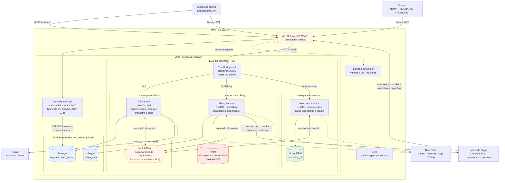
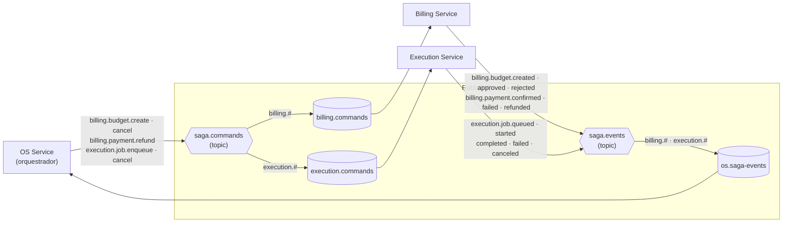
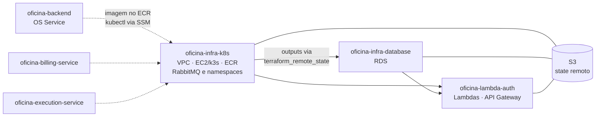
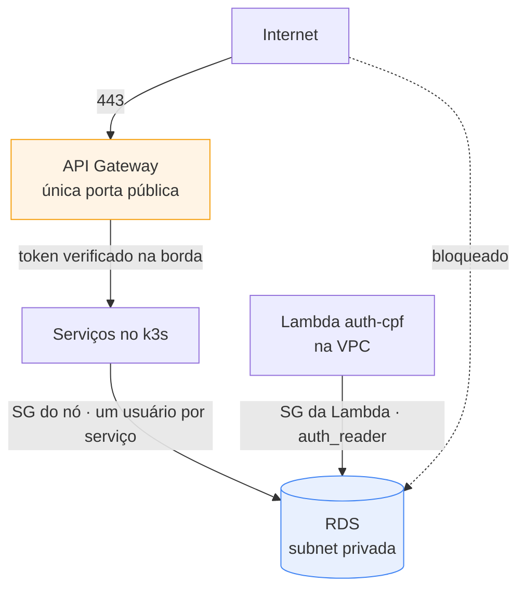

# Diagrama de Componentes

Arquitetura final da Fase 4: três microsserviços, cada um com o próprio banco, conversando por RabbitMQ numa saga orquestrada, atrás de um API Gateway. As decisões estão nas ADRs 009 a 015.

---

## Visão geral

**Nenhum serviço acessa o banco de outro, e o próprio banco garante isso:** cada serviço tem um usuário que só conecta no próprio database (o `CONNECT` do `PUBLIC` é revogado), e o MongoDB e o Redis só existem no namespace do serviço dono. A Lambda de CPF lê `customers` porque faz parte da fronteira do OS Service ([ADR-014](../adr/adr-014-lambda-de-autenticacao-e-a-tabela-customers.md)), com um usuário que só enxerga quatro colunas.

---

## Comunicação e fluxo da saga

Os serviços só conversam por mensagens. O **OS Service orquestra** ([ADR-011](../adr/adr-011-saga-orquestrada.md)): manda **comandos** para a exchange `saga.commands` e reage aos **eventos** que os outros publicam em `saga.events`. Billing e Execution não se conhecem.

Cada fila tem três filas de espera (5 s, 30 s, 2 min) e uma DLQ. Toda mensagem sai por um **outbox transacional** (gravada junto com a mudança de estado) e é consumida de forma **idempotente**. Contrato completo em [contratos-de-mensagens.md](contratos-de-mensagens.md).

**O fluxo de uma OS:**

| # | Quem age | O que acontece | Status da OS |
|---|---|---|---|
| 1 | Equipe → OS | Abre a OS, faz o diagnóstico, adiciona serviços e peças | `RECEIVED` → `IN_DIAGNOSIS` |
| 2 | Equipe → OS | Pede a aprovação: a saga começa, `billing.budget.create` | `AWAITING_APPROVAL` |
| 3 | Billing | Gera o orçamento, `billing.budget.created` | |
| 4 | Cliente → Billing | Aprova (token da Lambda de CPF); o Billing cria o checkout no Mercado Pago; `billing.budget.approved`; o OS reserva as peças | `AWAITING_PAYMENT` |
| 5 | Mercado Pago → Billing | Webhook do pagamento aprovado, `billing.payment.confirmed`; o OS manda `execution.job.enqueue` | `PAID` |
| 6 | Mecânico → Execution | Diagnóstico, reparo e conclusão; `execution.job.started` e `completed` | `IN_PROGRESS` → `COMPLETED` |
| 7 | Equipe → OS | Entrega ao cliente | `DELIVERED` |

**Compensações** (a saga desfaz o que já foi feito, conforme o passo):

| Falha | Compensação |
|---|---|
| Orçamento não pôde ser gerado | OS volta para diagnóstico |
| Cliente recusa, ou o prazo de aprovação vence | `billing.budget.cancel`; OS cancelada |
| Pagamento recusado, ou o prazo de pagamento vence | `billing.budget.cancel` (expira o checkout); peças devolvidas; OS cancelada |
| Falha na execução (`/fail` do mecânico) | `billing.payment.refund` (estorno no Mercado Pago); peças devolvidas; OS cancelada |
| Cancelamento pela equipe | Conforme o passo: cancela o orçamento, o job (`execution.job.cancel`) e estorna se já estava paga |

Diagramas de sequência do caminho feliz e das compensações em [diagramas-de-sequencia.md](diagramas-de-sequencia.md) e [contratos-de-mensagens.md](contratos-de-mensagens.md).

---

## Componentes

| Componente | Tecnologia | Responsabilidade | Decisão |
|---|---|---|---|
| **API Gateway** | AWS HTTP API | Única porta pública: roteia, aplica throttling, rotas públicas (CPF, health, docs, webhook) e as protegidas pelo authorizer | — |
| **Lambda authorizer** | Node.js, fora da VPC | Verifica o JWT HS256 na borda, decisão cacheada 5 min | — |
| **Lambda auth-cpf** | Node.js, na VPC | Valida o CPF, consulta o cliente e emite o JWT | [ADR-014](../adr/adr-014-lambda-de-autenticacao-e-a-tabela-customers.md) |
| **Traefik** | Ingress do k3s, NodePort 30080 | Roteia `/api`, `/api/billing` e `/api/execution` para o serviço certo | [ADR-015](../adr/adr-015-traefik-como-ingress.md) |
| **OS Service** | NestJS + Prisma, PostgreSQL | Ordem de serviço, clientes, veículos, catálogo e estoque; **orquestra a saga** (estado, prazos, compensações) | [ADR-009](../adr/adr-009-divisao-em-microsservicos.md), [ADR-011](../adr/adr-011-saga-orquestrada.md) |
| **Billing Service** | NestJS + Prisma, PostgreSQL + Redis | Orçamento, aprovação do cliente, Checkout Pro do Mercado Pago, webhook e estorno | [ADR-013](../adr/adr-013-redis-com-dono-unico.md) |
| **Execution Service** | NestJS + Mongoose, MongoDB | Fila de execução, diagnóstico e reparo, com linha do tempo do job | [ADR-012](../adr/adr-012-mongodb-no-execution-service.md) |
| **RabbitMQ** | 4.1, filas quorum | Comandos e eventos da saga, retentativa e DLQ | [ADR-010](../adr/adr-010-mensageria-com-rabbitmq.md) |
| **RDS PostgreSQL 16** | subnet privada | `oficina_db` (OS) e `billing_db` (Billing), um usuário por serviço | [RFC-002](../rfc/rfc-002-escolha-do-banco-de-dados.md) |
| **New Relic** | OpenTelemetry (OTLP) | Traces que atravessam o RabbitMQ, métricas da saga, logs com `sagaId`/`orderId`, painel e alertas | [observabilidade.md](../observabilidade.md) |

Cada serviço escala sozinho pelo HPA: OS de 1 a 3 réplicas, Billing e Execution de 1 a 2.

---

## Entrega

Seis repositórios, cada um com o seu pipeline. Os três de infraestrutura compartilham o state no S3; os três serviços seguem a mesma esteira: lint, testes unitários com cobertura mínima de 80%, testes de integração e E2E, Quality Gate do SonarCloud, build da imagem e, depois do merge na `main`, deploy automático no k3s ([esteira-ci-cd.md](esteira-ci-cd.md)).

**Ordem de apply:** `k8s` → `database` → `lambda`, e depois os deploys dos serviços. **Ordem de destroy:** exatamente a inversa.

---

## Fronteiras de segurança

- O banco **não** tem endereço público. Só os security groups do nó e da Lambda alcançam a porta 5432.
- RabbitMQ, MongoDB e Redis só existem dentro do cluster (`ClusterIP`), sem rota pela internet.
- Cada serviço valida o JWT de novo, e o cliente é **negado por padrão**: só entra nas rotas marcadas para ele, e só nos próprios dados.
- O acesso ao nó é por **AWS Systems Manager**, sem chave SSH e sem porta 22 aberta.
- Segredos do cluster vivem em `Secret` do Kubernetes; os da Lambda, em variável de ambiente criptografada com KMS ([ADR-004](../adr/adr-004-segredos-em-variavel-de-ambiente-na-lambda.md)). Em produção, um serviço sem `JWT_SECRET` se recusa a subir.
- Senha, token, CPF e documento são censurados nos logs antes de saírem do cluster.

### Limitação conhecida

A porta **30080** do Traefik, num nó com IP elástico público, **é alcançável pela internet**, contornando o API Gateway. Num desenho de produção isso se resolve com o security group do nó aceitando tráfego apenas dos ranges do API Gateway, ou com um Network Load Balancer interno. Está documentado aqui por ser uma consequência direta da escolha de custo do [ADR-001](../adr/adr-001-k3s-em-ec2-no-lugar-do-eks.md), e não um descuido.
