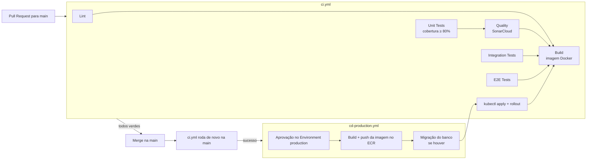

# Esteira de CI/CD dos microsserviços

Esteira padrão dos três serviços (OS Service, Billing Service, Execution Service). Cada repositório tem a sua cópia, independente das outras: um serviço é testado, analisado e publicado sem depender do pipeline dos demais. O `oficina-backend` (OS Service) é o modelo. Os outros copiam os dois arquivos de workflow e mudam só as variáveis do topo.

## Visão geral



## CI (`.github/workflows/ci.yml`)

Roda em todo Pull Request e em todo push para `main`.

| Job | O que faz | Reprova quando |
|---|---|---|
| `Lint` | ESLint | Qualquer erro de lint |
| `Unit Tests (coverage)` | `npm test -- --coverage` e guarda o `coverage/lcov.info` como artefato | Um teste falha ou a cobertura de `domain/` + `application/` fica abaixo de 80% (`coverageThreshold`) |
| `Quality (SonarCloud)` | Envia o código e o lcov ao SonarCloud e **espera o Quality Gate** (`sonar.qualitygate.wait=true`) | O Quality Gate reprova: cobertura do código novo < 80%, bugs, vulnerabilidades, *security hotspots* não revisados ou duplicação acima do limite |
| `Integration Tests` | Testes contra um Postgres de verdade (container de serviço do Actions) | Um teste falha |
| `E2E Tests` | Sobe a API e faz requisições HTTP | Um teste falha |
| `BDD` | Roda o fluxo completo da OS descrito em Gherkin (`test/bdd/features`), só no `oficina-backend` | Um cenário falha |
| `Build` | `npm run build` e `docker build` (sem push) | O código não compila ou a imagem não builda |

O `Build` só roda se todos os outros passarem.

### Cobertura: o que entra na conta

O Jest mede e cobra 80% das camadas de **domínio e aplicação** (`collectCoverageFrom` no `package.json`), onde ficam as regras de negócio. O `sonar-project.properties` usa o mesmo recorte em `sonar.coverage.exclusions`. Controllers, repositórios, módulos do Nest e bootstrap são exercitados pelos testes de integração e E2E. Assim o número que o SonarCloud mostra é o mesmo que o CI cobra.

### SonarCloud

- A análise automática do SonarCloud fica **desligada**: a análise vem do CI, que é quem tem o relatório de cobertura.
- A organização e a chave do projeto ficam nas variáveis `SONAR_ORGANIZATION` e `SONAR_PROJECT_KEY` do job `quality`. O token fica no secret `SONAR_TOKEN` do repositório.
- O SonarCloud comenta o resultado do Quality Gate no próprio PR.
- **Primeira análise da `main` de um repositório novo:** o job `Quality (SonarCloud)` falha com `QUALITY GATE STATUS: FAILED`, mas o gate na verdade fica sem status (`NONE`): todas as condições são sobre código novo, e ainda não existe análise anterior para comparar. Basta rodar de novo o job (*Re-run failed jobs*); a partir da segunda análise o gate é calculado normalmente. Aconteceu no `oficina-billing-service` em 2026-11-17.
- **Actions de terceiros são fixadas pelo hash do commit**, com a versão em comentário (`uses: dono/action@<sha> # v1.2.3`). Uma tag como `@v8` pode ser movida pelo dono para outro código, e o SonarCloud trata isso como vulnerabilidade (a regra do Quality Gate reprova o PR). As actions oficiais do GitHub (`actions/*`) podem ficar na tag.

### O que o SonarCloud cobra além do código

A primeira análise da `main` olha o repositório inteiro, inclusive workflows, Dockerfile e manifestos k8s. Para um serviço novo já nascer com o Quality Gate verde:

| Onde | Regra | Como está feito |
|---|---|---|
| Workflows e Dockerfile | Nada de scripts de instalação de terceiros | `npm ci --ignore-scripts`. Os motores do Prisma vêm do `prisma generate` e o bcrypt já vem compilado |
| Workflows e Dockerfile | Versão exata do que roda | `npm run prisma:*` (usa o Prisma do `package-lock.json`) em vez de `npx prisma` |
| Workflows | Actions de terceiros fixadas | Hash do commit, com a versão em comentário |
| Workflows | Nenhuma senha no código | O Postgres do CI roda sem senha (`POSTGRES_HOST_AUTH_METHOD: trust`): ele é descartável e só existe durante o job |
| `cd-production.yml` | Código de fork não roda com credenciais | O deploy exige que o CI tenha sido um `push` no próprio repositório |
| Dockerfile | Container sem root | `USER node` |
| Manifestos k8s | Sem token da API do Kubernetes nos pods | `automountServiceAccountToken: false` |
| Manifestos k8s | Limite de memória em todo container | `resources.limits.memory`, inclusive no job de migração |
| Manifestos k8s | Limite de disco temporário em todo container (regra `kubernetes:S6870`, nota de segurança) | `resources.requests/limits.ephemeral-storage`: sem ele, um container pode encher o disco do nó e derrubar os outros |
| Código | Aleatório seguro | `crypto.randomInt`/`randomUUID`, nunca `Math.random` |

Os `docker-compose*.yml` ficam fora da análise (`sonar.exclusions`): são só para desenvolvimento local e têm senhas fixas de propósito.

O job `Build` termina com um **smoke test da imagem**: confere que ela não roda como root, que o bcrypt carrega e que os motores do Prisma estão lá. Isso pega a quebra que o `--ignore-scripts` poderia causar antes do deploy.

## CD (`.github/workflows/cd-production.yml`)

Dispara quando o CI termina com sucesso na `main`, ou à mão (**Actions → Deploy to Production → Run workflow**).

1. **Aprovação.** O job roda no Environment `production`, que exige aprovação do dono do repositório antes de seguir.
2. **Acha o nó k3s** pela tag `Name=oficina-backend-k3s-node`. O IP muda a cada recriação da infra, então nada fica fixo no workflow.
3. **Pega o kubeconfig via SSM**, sem abrir a porta do SSH.
4. **Builda e publica a imagem** no ECR com a tag do commit (e `latest`).
5. **Migração** (só se existir `k8s/migration-job.yaml`): roda o Job e espera terminar antes do deploy.
6. **Deploy:** aplica `deployment.yaml` com a imagem nova e, se existirem, `service.yaml`, `ingress.yaml` e `hpa.yaml`. Depois espera o rollout.

Namespace, ConfigMap e Secret do serviço **não** são aplicados pelo CD: o Secret carrega senhas que não ficam no repositório. Eles são aplicados à mão logo depois de a infra subir (ver `k8s/README.md`).

### Para usar em outro serviço

Copie `ci.yml`, `cd-production.yml` e `sonar-project.properties` e ajuste:

| Onde | Variável | Exemplo (Billing Service) |
|---|---|---|
| `cd-production.yml` | `ECR_REPOSITORY` | `oficina-billing-service` |
| `cd-production.yml` | `K8S_NAMESPACE` | `billing` |
| `cd-production.yml` | `DEPLOYMENT_NAME` | `oficina-billing-service` |
| `ci.yml` (job `quality`) | `SONAR_PROJECT_KEY` | `Luizustavo_oficina-billing-service` |
| `sonar-project.properties` | `sonar.projectKey`, `sonar.projectName`, recorte de cobertura | conforme as pastas do serviço |

Os jobs de integração/E2E mudam conforme o banco do serviço (Postgres para Billing, MongoDB para Execution), mas os nomes dos jobs continuam os mesmos, para a proteção de branch ser igual nos três repositórios.

## Proteção da `main`

Em todos os repositórios de serviço:

- Push direto na `main` é recusado: toda mudança entra por Pull Request.
- O PR só pode ser mergeado com os checks obrigatórios verdes: `Lint`, `Unit Tests (coverage)`, `Quality (SonarCloud)`, `Integration Tests`, `E2E Tests`, `BDD` (no `oficina-backend`) e `Build`.
- A regra vale também para o administrador (`enforce_admins`).

Para conferir:

```bash
gh api repos/Luizustavo/<repositório>/branches/main/protection \
  --jq '{pr: (.required_pull_request_reviews != null), checks: .required_status_checks.contexts, admins: .enforce_admins.enabled}'
```
